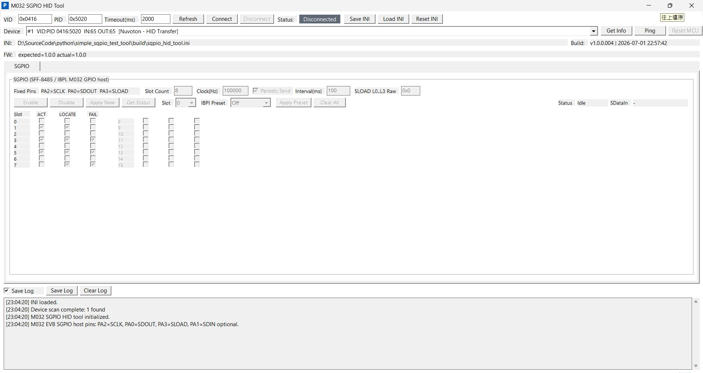

# SGPIO HID Tool

## Release size

Release x64 EXE: 760320 bytes (comparable baseline 2849792).
Features, static runtime, required files and Win32 settings are retained.
See SELF_CHECK.md and the sanitized [verification record](docs/verification/exe-slimming-20261025.json)
for actual scope, measurements and limitations.

## Publication and local data

The current source/layout and native delivery are published without personal INIs,
logs or debugger/user options. Defaults are generated locally where supported;
existing local settings/data are not deleted by clean or publication. Current-tree
index removals do not erase earlier Git history. See SELF_CHECK.md for actual
build/test results and hardware limitations.


Windows MFC GUI tool and M032/M261 USB HID firmware for using an EVB as an SGPIO bridge board.

The PC GUI connects to the bridge EVB over USB HID. `SGPIO Output` generates SGPIO frames for a target device, while `SGPIO Monitor` passively captures and decodes an independent external SGPIO source. The main output use case is validating external SGPIO target/device firmware such as:

- `M031BSP_Software_SGPIO`
- `M031BSP_SPI_SGPIO`

## Current Scope

- Bridge board: M032 EVB or M261 EVB running the firmware in this workspace.
- PC transport: Windows HID class driver, 64-byte HID reports.
- SGPIO output role: host/initiator output for `SCLOCK/SCLK`, `SDATA OUT`, and `SLOAD`.
- SGPIO monitor role: passive external-source input on separate M032/M261 pins, with protocol-level ACT/LOCATE/FAIL decode.
- Target validation: 8-slot and 16-slot SGPIO receive/decode testing.
- Clock range: 100 kHz to 400 kHz.
- Monitor capture: M032 and M261 firmware; 3.2 MS/s Timer2-triggered PDMA capture with Auto/4/8/16-slot decode.
- Not in scope: Pico board support, I2C bridge behavior, PMBus/SMBus tabs, full `SDATA IN` frame capture.

## UI Screenshot



## Quick Start

1. Build and flash M032 or M261 firmware `1.1.0` from this workspace.
2. Connect the bridge EVB USB port to the PC.
3. Wire bridge `PA2/PA0/PA3/GND` to the target SGPIO `SCLK/SDATA OUT/SLOAD/GND`.
4. Build or launch the PC tool at `build\SgpioHidTool.exe`.
5. In the GUI, keep VID `0x0416` and PID `0x5020`, then click `Refresh`.
6. Select the bridge device or keep `Auto Select`, then click `Connect`.
7. Click `Get Info`; the firmware should report `m032-sgpio-bridge/1.1.0` or `m261-sgpio-bridge/1.1.0`.
8. In `SGPIO Output`, choose slot count, clock, interval, SLOAD raw bits, and slot ACT/LOCATE/FAIL checkboxes.
9. Click `Enable` to start SGPIO output.
10. Verify the target UART log and logic analyzer decode.
11. Click `Disable` before rewiring, reflashing, or changing fixed-pin ownership.

## Hardware Wiring

EVB host bridge to SGPIO target:

| Bridge EVB pin | Bridge direction | SGPIO signal | Target side |
| --- | --- | --- | --- |
| `PA2` | Output | `SCLK` / `SCLOCK` | Target clock input |
| `PA0` | Output | `SDATA OUT` | Target data input |
| `PA3` | Output | `SLOAD` | Target frame/load input |
| `GND` | Ground | Ground | Target ground |
| `PA1` | Input | `SDATA IN` optional | Target data output, if available |

The bundled M032 and M261 bridge firmware uses fixed pins. The GUI does not expose alternate SGPIO pin mux choices.

External SGPIO source to the independent M032/M261 monitor inputs:

| Bridge EVB monitor pin | Direction | SGPIO signal | External source side |
| --- | --- | --- | --- |
| `PA6` | Input | `SCLOCK` | Source clock output |
| `PA4` | Input | `SDATA` | Source data output |
| `PA5` | Input | `SLOAD` | Source load/frame output |
| `GND` | Ground | Ground | Source ground |

The monitor pins are inputs and do not generate SGPIO. Connect one external source only, use 3.3 V-compatible logic, and connect common ground before the signal wires. The monitor path is independent of `PA2/PA0/PA3`; the GUI nevertheless prevents Output and Monitor from running simultaneously so first-version timing validation remains deterministic.

For the referenced `M031BSP_Software_SGPIO` target, the default target receive wiring is also `PA2=SCLK`, `PA0=SDATA OUT`, and `PA3=SLOAD`. Its debug UART is typically `UART0` at `115200 8N1`.

For the referenced `M031BSP_SPI_SGPIO` target, keep GUI `SLOAD L0..L3 Raw` at the default `0x0` unless the target firmware explicitly expects another value.

Always connect common ground before SGPIO signals. Check target and EVB voltage domains before wiring.

## Build PC Tool

Supported PC platform:

- Windows 10/11 x64
- Visual Studio 2022 C++ toolchain with MFC support
- Native MFC executable

Build from a Visual Studio developer PowerShell:

```bat
powershell -NoProfile -ExecutionPolicy Bypass -File scripts\build_mfc.ps1 -Configuration Release -Platform x64
```

Output:

- `build\SgpioHidTool.exe`
- `build\obj\x64\Release\...` intermediate build files

Clean command:

```bat
scripts\clean_mfc.bat
```

The clean script removes PC build intermediates and debug artifacts only:

- Allowlisted compiler files under `build\obj\` (never a recursive directory purge)
- `build\SgpioHidTool.lib`
- `build\SgpioHidTool.exp`
- `build\*.pdb`, `build\*.ilk`, `build\*.idb`, `build\*.iobj`, `build\*.ipdb`

It intentionally preserves:

- `build\SgpioHidTool.exe`
- `build\sgpio_hid_tool.ini`
- `build\test_log\`

EXE/INI/logs/data/unknown files are also preserved inside obj/tests/verify. All
target paths are preflighted for reparse points before any compiler-file deletion.
PC sources remain in `src`, automation in `scripts`, screenshots in `docs/images`;
the vendor/firmware `demo_code` tree keeps its existing build contracts.

## Build And Flash Firmware

The EVB must be flashed with this workspace HID bridge firmware before the GUI can control SGPIO. The PC GUI alone is not enough; without this firmware, the GUI will not see the expected HID bridge protocol.

Keil projects:

- M031/M032 HID IAP bootloader: `demo_code\M031BSP_USB_HID_SGPIO\SampleCode\ISP_HID\Keil\ISP_HID.uvprojx`
- M031/M032 SGPIO bridge application: `demo_code\M031BSP_USB_HID_SGPIO\SampleCode\Template\Keil\Template.uvprojx`
- M261 HID IAP bootloader: `demo_code\M261BSP_USB_HID_SGPIO\SampleCode\ISP_HID\Keil\ISP_HID.uvprojx`
- M261 SGPIO bridge application: `demo_code\M261BSP_USB_HID_SGPIO\SampleCode\Template\Keil\Template.uvprojx`

M031/M032 IAP layout:

- Bootloader: `0x00000000..0x00003FFF` (`16 KB`)
- SGPIO bridge application: `0x00004000..0x0001FFFF` (`112 KB`)
- App CRC word: `0x0001FFFC`
- Bootloader USB HID PID: `0x3F00`
- Application USB HID PID: `0x5020`

M261/M263KIAAE IAP layout:

- Bootloader: `0x00000000..0x0000FFFF` (`64 KB`)
- SGPIO bridge application: `0x00010000..0x0007FFFF` (`448 KB`)
- App CRC word: `0x0007FFFC`
- Bootloader USB HID PID: `0x3F00`
- Application USB HID PID: `0x5020`

Typical flow:

1. Build and flash `ISP_HID.uvprojx` first when preparing a board for HID app update.
2. Build `Template.uvprojx`; its post-build step generates a padded app image with CRC at `SampleCode\Template\Keil\obj\template.bin`.
3. Use `simple_programming_tool` to program that padded app image while the board is in HID ISP bootloader mode.
4. Reset or power-cycle the EVB.
5. Confirm Windows enumerates the application HID device.
6. Launch `build\SgpioHidTool.exe`.
7. Click `Refresh`, `Connect`, `Ping`, and `Get Info`.

The top-level GUI includes `Return Bootloader`. It sends `BRIDGE_CMD_ENTER_IAP` (`0x04`) to the running bridge application, erases only the application CRC word, disconnects from the app HID device, and resets through the bootloader path. After the bootloader enumerates as `VID 0x0416`, `PID 0x3F00`, use `simple_programming_tool` to program a valid padded bridge application image. This button is an app-side bridge self-update entry point; it is not a target-board programming flow.

Default USB identity:

- VID `0x0416`
- PID `0x5020`

Expected firmware info:

- `m032-sgpio-bridge/1.1.0`
- `m261-sgpio-bridge/1.1.0`

Important firmware files:

- `demo_code\M031BSP_USB_HID_SGPIO\SampleCode\ISP_HID\` - USB HID IAP bootloader.
- `demo_code\M031BSP_USB_HID_SGPIO\SampleCode\iap_mailbox.h` - shared app-to-bootloader mailbox definition.
- `demo_code\M031BSP_USB_HID_SGPIO\SampleCode\Template\m031_bridge_sgpio.c` - Timer0 + PDMA SGPIO waveform generator.
- `demo_code\M031BSP_USB_HID_SGPIO\SampleCode\Template\m031_bridge_sgpio.h` - SGPIO limits and bridge API.
- `demo_code\M031BSP_USB_HID_SGPIO\SampleCode\Template\m031_bridge_sgpio_monitor.c` - Timer2 + PDMA external-source capture and protocol decoder.
- `demo_code\M031BSP_USB_HID_SGPIO\SampleCode\Template\m031_bridge_sgpio_monitor.h` - monitor states, error flags, and status data.
- `demo_code\M031BSP_USB_HID_SGPIO\SampleCode\Template\hid_tool_api.c` - HID command dispatcher.
- `demo_code\M031BSP_USB_HID_SGPIO\SampleCode\Template\bridge_protocol.h` - HID command IDs and status codes.
- `demo_code\M031BSP_USB_HID_SGPIO\SampleCode\Template\bridge_version.h` - firmware version string.
- `demo_code\M031BSP_USB_HID_SGPIO\SampleCode\Template\hid_transfer.h` - USB VID/PID and HID settings.
- `demo_code\M031BSP_USB_HID_SGPIO\SampleCode\Template\Keil\generateChecksum.bat` - SRecord post-build padding and CRC generation.
- `demo_code\M261BSP_USB_HID_SGPIO\SampleCode\ISP_HID\` - M261 USB HID IAP bootloader.
- `demo_code\M261BSP_USB_HID_SGPIO\SampleCode\Template\m261_bridge_sgpio.c` - M261 Timer0 + PDMA SGPIO waveform generator.
- `demo_code\M261BSP_USB_HID_SGPIO\SampleCode\Template\m261_bridge_sgpio_monitor.c` - M261 Timer2 + PDMA0 external-source capture and protocol decoder.
- `demo_code\M261BSP_USB_HID_SGPIO\SampleCode\Template\m261_bridge_sgpio_monitor.h` - M261 monitor states, error flags, and status data.
- `demo_code\M261BSP_USB_HID_SGPIO\SampleCode\Template\Keil\Template.uvprojx` - M261 application project with checksum post-build.

M261 firmware `1.1.0` is source-level aligned with M032 for both SGPIO Output and SGPIO Monitor. It uses the same fixed pins and HID payloads, so the GUI does not need a board-specific mode. Hardware validation on an M261 EVB still needs to be run before treating its output or monitor paths as production-verified.

## SGPIO Signal Behavior

The bridge emits SGPIO with Timer0-triggered PDMA writes to `PA->DOUT`. One SGPIO clock is built from one low half-period and one high half-period table entry.

Signals:

- `SCLK` / `SCLOCK`: output clock on bridge `PA2`. Targets should sample on the rising edge.
- `SDATA OUT`: output data on bridge `PA0`. This is host-to-target slot state data.
- `SLOAD`: output frame marker on bridge `PA3`. It idles high, goes low for sync, then returns high for the restart marker and L0..L3 bits.
- `SDATA IN`: optional target-to-host input on bridge `PA1`. Current firmware reports the pin level in status but does not implement full returned-frame capture.

Frame layout:

```text
5 clocks    SLOAD=0, SDATA OUT=0 low-sync run
1 clock     SLOAD=1, SDATA OUT=0 restart marker
4 clocks    SLOAD L0..L3 raw bits, LSB-first
N clocks    SDATA OUT ACT, LOCATE, FAIL triplets per slot
pad clocks  SLOAD=1, SDATA OUT=0 until the frame reaches a 16-clock boundary
```

Slot data is LSB slot order. Each slot consumes three `SDATA OUT` bits:

```text
slot N bit 0 = ACT
slot N bit 1 = LOCATE
slot N bit 2 = FAIL
```

Mask bit meaning:

- bit 0 = slot 0
- bit 1 = slot 1
- bit 2 = slot 2
- and so on through slot 15

Example 8-slot pattern:

```text
ACT=0x002A LOCATE=0x00AA FAIL=0x00AA
raw LSB bytes = 38 8E C3
slots = S0=000 S1=111 S2=000 S3=111 S4=000 S5=111 S6=000 S7=011
```

Example 16-slot pattern:

```text
ACT=0x1111 LOCATE=0xAAAA FAIL=0x4444
raw LSB bytes = 11 15 51 11 15 51
slots = S0=100 S1=010 S2=001 S3=010 ... S15=010
```

## SGPIO Monitor Behavior

`SGPIO Monitor` is intended to test and validate another SGPIO source without using the bridge output pins. On `Arm`, the M032 or M261 firmware configures `PA6/PA4/PA5` as inputs and waits for a falling edge on `PA5 SLOAD`. That edge starts Timer2; Timer2 requests PDMA channel 1 to snapshot `PA->PIN` at 3.2 MS/s. M261 selects its 48 MHz PCLK1 as the Timer2 source so this rate is exact. One 2304-sample capture covers 720 us, including a full 16-slot frame at the minimum 100 kHz clock.

The firmware then decodes the captured frame locally and sends a compact result to the GUI:

- monitor state: `Idle`, `Armed`, `Capturing`, `Complete`, `Timeout`, or `Error`
- measured SCLOCK frequency and average high/low time
- expected and detected slot count
- SLOAD L0..L3 raw value
- sample, rising-edge, and decoded-bit counts
- ACT, LOCATE, and FAIL masks for up to 16 slots
- no-trigger, no-clock, clock-range, SLOAD-sync, incomplete-frame, and capture-timeout flags

The monitor expects the same frame layout described above: five SLOAD-low sync clocks, one SLOAD-high restart clock, then ACT/LOCATE/FAIL slot triplets. It does not stream the raw 2304-sample waveform to the PC; use a logic analyzer when electrical-level waveform inspection is required.

## GUI Guide

Top-level HID controls:

- `VID` / `PID`: HID filter. Defaults are `0x0416` and `0x5020`.
- `Timeout(ms)`: HID transaction timeout. Default is `2000`.
- `Refresh`: scan matching HID devices.
- `Device`: select a specific scanned device, or keep `Auto Select`.
- `Connect`: open the HID bridge and automatically query firmware info.
- `Disconnect`: close the HID bridge.
- `Get Info`: read the bridge name/version and reset reason.
- `Ping`: basic HID transaction check.
- `Reset MCU`: send bridge reset command, then disconnect and rescan.
- `Save INI` / `Load INI` / `Reset INI`: save, load, or restore GUI state.
- `Save Log`: manually save the visible GUI log when the checkbox is enabled.

`SGPIO Output` tab controls:

- `Fixed Pins`: read-only reminder for `PA2=SCLK`, `PA0=SDOUT`, `PA3=SLOAD`, `PA1=SDIN(optional)`.
- `Slot Count`: number of logical slots, `1` to `16`. Use `8` for normal 8-slot tests and `16` for full-width tests.
- `Clock(Hz)`: SGPIO clock. Firmware clamps to `100000` through `400000`.
- `Periodic Send`: when checked, the bridge repeats SGPIO frames.
- `Interval(ms)`: repeat interval. Firmware clamps to `20` through `5000`; `100` ms is a good logic-analyzer bring-up value.
- `SLOAD L0..L3 Raw`: four SLOAD raw bits. Use `0x0` for the current target projects unless a test explicitly needs L0..L3 changes.
- `Enable`: sends SGPIO config/apply commands and starts output.
- `Apply Now`: updates masks/timing while SGPIO is already enabled.
- `Disable`: stops SGPIO and releases the fixed pins to idle.
- `Get Status`: reads firmware state and current `SDATA IN` pin level.
- Slot checkboxes: each row maps to one slot. Check `ACT`, `LOCATE`, and/or `FAIL` to set the corresponding mask bit.
- `Slot` + `IBPI Preset` + `Apply Preset`: quickly apply `Off`, `Activity`, `Locate`, `Fail`, combined states, or `ALL` to one slot.
- `Clear All`: clears all slot ACT/LOCATE/FAIL checkboxes.

`SGPIO Monitor` tab controls:

- `Fixed Input Pins`: read-only wiring reminder for `PA6=SCLOCK`, `PA4=SDATA`, and `PA5=SLOAD`.
- `Expected Slots`: use `Auto Detect` for a normal 4/8/16-slot frame, or select a fixed slot count when validating a known source.
- `Trigger Timeout(ms)`: time to wait for the SLOAD falling edge, from `100` to `30000`; default is `3000`.
- `Arm`: sends monitor config and arm commands, then polls status every 100 ms.
- `Stop`: cancels an armed or active capture and returns firmware to `Idle`.
- `Get Status`: reads one status result without arming a new capture.
- `State`, `Clock`, `High / Low`, `Frame`, `Capture`, and `Errors`: capture progress, timing, frame summary, and validation flags.
- Slot table: decoded ACT/LOCATE/FAIL values. `1` and `0` are captured data bits; `-` is outside the detected frame.

Recommended external-source monitor validation:

1. Keep `SGPIO Output` disabled.
2. Connect external source `SCLOCK/SDATA/SLOAD/GND` to bridge `PA6/PA4/PA5/GND`.
3. Select `Auto Detect` and leave timeout at `3000` ms.
4. Click `Arm`, then start one frame from the external source.
5. Confirm state reaches `Complete`, clock is within 100-400 kHz, and `Errors` is `None`.
6. Compare detected slots and ACT/LOCATE/FAIL rows with the source configuration.
7. A `Timeout` with `No trigger` means no SLOAD falling edge arrived before the configured timeout.

Recommended first validation:

1. Set `Slot Count=8`, `Clock=100000`, `Periodic Send=checked`, `Interval=100`, `SLOAD L0..L3 Raw=0x0`.
2. Use checkboxes or presets to create a simple pattern, for example slot 1 `ALL`.
3. Click `Enable`.
4. On the target UART log, confirm the decoded masks and slot list.
5. On a logic analyzer, decode `SCLK`, `SDATA OUT`, and `SLOAD`; confirm five low-sync clocks and the expected raw bytes.
6. Click `Apply Now` after changing masks.
7. Test `Slot Count=16` only after the 8-slot path is stable.

## HID Bridge Protocol

The bridge uses 64-byte HID reports with a fixed 6-byte header:

```text
byte 0      magic 0xA5
byte 1      command
byte 2      sequence
byte 3      status in response
byte 4..5   payload length, little-endian
byte 6..63  payload
```

SGPIO commands:

- `0x74` - SGPIO output config, slot count and clock.
- `0x75` - SGPIO output apply, enable/periodic/interval/SLOAD/masks.
- `0x76` - SGPIO output status.
- `0x77` - SGPIO output off.
- `0x78` - SGPIO monitor config, expected slots and trigger timeout.
- `0x79` - SGPIO monitor arm.
- `0x7A` - SGPIO monitor status and decoded result.
- `0x7B` - SGPIO monitor stop.

See `docs\SGPIO_BRIDGE.md` for payload details.

## Configuration

Runtime INI:

- `sgpio_hid_tool.ini`

The default INI is created beside `SgpioHidTool.exe`. Values stored under the exe directory are saved relative to the exe where applicable. For example, the default INI path is saved as:

```ini
[APP]
ini_path=sgpio_hid_tool.ini
```

Saved state includes:

- HID VID/PID
- HID timeout
- selected device label
- save-log checkbox state
- expected and last-seen firmware version
- SGPIO slot count, clock, periodic setting, interval, SLOAD raw bits, and ACT/LOCATE/FAIL masks
- SGPIO monitor expected slot count and trigger timeout

This repository intentionally keeps `build\SgpioHidTool.exe`, `build\sgpio_hid_tool.ini`, and sanitized captures under `build\test_log` so first-time users can launch the tool and compare known-good SGPIO logs. Keep these files free of local absolute paths before publishing. Ad-hoc logs saved directly under `build\*.log` remain local-only.

## Project Structure

- `src\` - MFC app, HID transport, SGPIO Output/Monitor tabs, app state, logging, and config helpers.
- `scripts\` - MFC build, clean, release, and version helper scripts.
- `docs\` - SGPIO bridge protocol notes and MFC DPI scaling guide.
- `demo_code\` - M032 and M261 EVB HID bridge firmware projects.
- `build\` - generated PC build output and local runtime files.
- `SELF_CHECK.md` - latest verification record.
- `HANDOFF.md` - current implementation handoff notes.
- `AGENTS.md` - local development rules for this workspace.

## GitHub Upload Notes

Before uploading a public copy, keep source, scripts, docs, firmware project files, project metadata, and these user-facing build artifacts:

- `build\SgpioHidTool.exe`
- `build\sgpio_hid_tool.ini`
- `build\test_log\`

Exclude local and generated artifacts:

- `build\obj\`
- `build\*.pdb`, `build\*.ilk`, `build\*.idb`, `build\*.iobj`, `build\*.ipdb`
- `build\*.lib`, `build\*.exp`
- `build\*.log`
- root `teraterm.log`
- Keil `lst\`, `obj\`, `*.uvguix.*`, and local debug-driver INI files

The included `.gitignore` is set up for this split.

Known local-sensitive patterns to watch for before publishing:

- absolute Windows drive or user-profile paths
- user-specific Keil UI files such as `Template.uvguix.<user>`
- Nu-Link local debug configuration files
- logs that include machine paths, COM-port names, or lab-only device serial details

## Verification

PC build:

```bat
powershell -NoProfile -ExecutionPolicy Bypass -File scripts\build_mfc.ps1 -Configuration Release -Platform x64
```

Firmware syntax check, when `arm-none-eabi-gcc` is available:

```bat
arm-none-eabi-gcc -mcpu=cortex-m0 -mthumb -std=gnu99 -fsyntax-only ^
  -Idemo_code\M031BSP_USB_HID_SGPIO\Library\CMSIS\Core\Include ^
  -Idemo_code\M031BSP_USB_HID_SGPIO\Library\Device\Nuvoton\M031\Include ^
  -Idemo_code\M031BSP_USB_HID_SGPIO\Library\StdDriver\inc ^
  -Idemo_code\M031BSP_USB_HID_SGPIO\SampleCode\Template ^
  demo_code\M031BSP_USB_HID_SGPIO\SampleCode\Template\m031_bridge_sgpio.c ^
  demo_code\M031BSP_USB_HID_SGPIO\SampleCode\Template\m031_bridge_sgpio_monitor.c ^
  demo_code\M031BSP_USB_HID_SGPIO\SampleCode\Template\hid_tool_api.c ^
  demo_code\M031BSP_USB_HID_SGPIO\SampleCode\Template\main.c
```

Hardware smoke test:

1. Flash firmware `1.1.0` to an M032 or M261 EVB.
2. Launch `build\SgpioHidTool.exe`.
3. Scan/connect VID `0x0416`, PID `0x5020`.
4. Click `Ping`.
5. Click `Get Info`; expect the matching `m032-sgpio-bridge/1.1.0` or `m261-sgpio-bridge/1.1.0` string.
6. Wire `PA2/PA0/PA3/GND` to the SGPIO target.
7. Set `Slot Count=8`, `Clock=100000`, `Periodic Send=checked`, `Interval=100`, `SLOAD L0..L3 Raw=0x0`.
8. Enable SGPIO and confirm target UART decode.
9. Capture `SCLK`, `SDATA OUT`, and `SLOAD` with a logic analyzer.
10. Repeat with a 16-slot pattern after the 8-slot capture is correct.
11. Disable output, wire an independent SGPIO source to `PA6/PA4/PA5/GND`, then use `SGPIO Monitor` -> `Arm`.
12. Trigger one external frame and compare the decoded clock, slot count, masks, and error flags with the source settings.

See `SELF_CHECK.md` for the latest verification result captured in this workspace.
